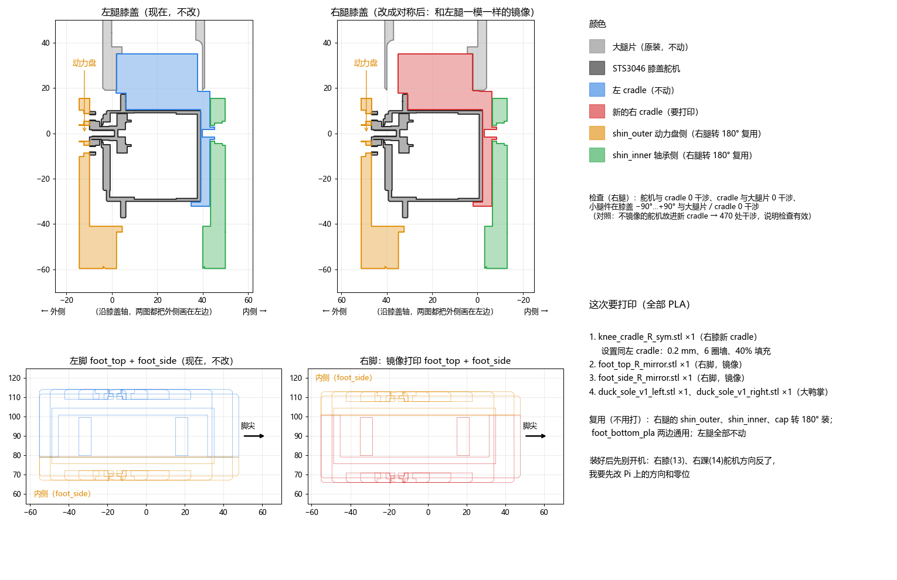

# Symmetric legs retrofit (2026-11-11 to 11-13)

[中文](左右腿对称改造记录.md)

## In one sentence

The right leg had been built from **the same parts as the left leg, just turned around**: the knee and ankle servo horns faced **outward** on the left leg but **inward** on the right. After rebuilding the right leg as a **mirror** of the left (horns outward on both legs), the duck **no longer drifts to one side** when walking straight, and left and right turns are **much more balanced**.

## The problem

- Walking straight always needed a correction to one side. On 11-10 the gyro heading hold kept adding −4 to −13 °/s, and the manual heading trim was −0.3.
- Left turns were clearly weaker than right turns, and side steps were good one way and poor the other.
- Swapping servos, re-zeroing and a turn bias (TURN_BIAS) each fixed only part of it.

## Finding the cause

1. **Mass distribution is not the cause.** The official sim model's legs are already mass-mirror-symmetric. `tools/leg_symmetry.py` shows per-part CoM differences between left and right of only 0.6–1.4 mm, and each leg weighs 413.5 g. A rigid sim therefore cannot see the build difference.
2. **The difference is the play on the horn side.** The servo output (horn) side is a tight joint. The other side rides on a bearing with a little sideways play. With the right leg turned around, both legs have that play on the same side of the body, so it is no longer left/right symmetric.
3. **Checked in sim.** We added horn-side roll play to the knee and ankle (`tools/knee_play_sim.py`, the `DUCK_PLAY` env var in `tools/mjlab_sim_check.py`). We then compared "same" (turned around) with "mirror" layouts in 18 runs each (`tools/play_compare.sh` + `play_compare_table.py`):
   - the turned-around layout gives a **sideways drift of +7 to +12 mm/s**;
   - it also gives a **left/right turn difference of 4–5 °/s**;
   - neither layout falls.

Decision: **make the right leg a mirror of the left.**

## What changed

| Part | How | Files |
| --- | --- | --- |
| Right knee cradle (servo holder) | New print. The left cradle's servo side is mirrored, then cut for the real right thigh sheets (M3 holes). | `cad/symmetric_legs/knee_cradle_R_sym.stl` (script `knee_v1c_right_sym.py`) |
| Right foot_top / foot_side | Mirrored print | `foot_top_R_mirror.stl`, `foot_side_R_mirror.stl` |
| Right foot with the slot for the Heima foot switch board | Mirrored, plus a 10.5 × 77 mm switch slot and 4 PCB holes | `foot_top_R_mirror_slot.stl`, `foot_side_R_mirror_slot.stl` (script `foot_R_switch_slot.py`) |
| shin_outer / shin_inner / cap | **No reprint needed.** These parts are strictly fore-aft symmetric (`tools/knee_fore_aft_check.py`), so turning them 180° on the right leg already gives the mirror. | — |
| Left leg | Unchanged | — |

- All parts are PLA.
- Before assembly, `tools/knee_R_fit.py` checked servo, cradle, thigh sheets and shin parts over −90° to +90°: 0 overlaps. As a control, the un-mirrored servo placed in the new cradle gives 470 overlaps, so the check works.
- Mirroring moves the robot CoM sideways by only about 0.3–0.4 mm. The sim model was already symmetric, so **no retraining was needed**.

## After the rebuild, change the Pi settings

Once the right knee (ID 13) and right ankle (ID 14) are mirrored, **those servos turn the other way**. Before power-on:

1. Add `"reversed_joints": ["right_knee", "right_ankle"]` to `~/duck_config.json` (the runtime's `joints_sign`).
2. Hold the leg straight and re-zero both servos: `tools/set_middle.py --id 13 --calibrate`, then `--id 14 --calibrate`.
3. Test the directions on the stand with a small move: give +10° and check that both shins and both feet move the same way.

> The first time we only checked the knee. A 10° ankle move was hard to judge, so we thought the ankle was fine. At power-on the right foot ended up about 90° off (= 2 × the 46° standing ankle angle), which proved the ankle was reversed too. **Change both joints.**

## Results (real duck, od29 policy, smooth board)

| | 11-10 old build | 11-13 symmetric |
| --- | --- | --- |
| Heading correction needed walking straight | constant −4 to −13 °/s | **about 0** (about −2 °/s drift left) |
| Right turn | −2 to −10 °/s | **−15 to −17 °/s** |
| Left turn | +1 to +11 °/s | **+9 to +14 °/s** |
| 87° turn | often timed out | 5–7 s |

The owner's verdict: left and right turns are clearly balanced now.

Notes:

- On a soft yoga mat or a hard dotted anti-slip mat, pitch rocking doubles and left turns fail again. A smooth hard board works best. That is a floor problem, not a symmetry problem.
- Left and right turns are still not identical (right is a bit faster). The rest comes mainly from the policy itself.

## Tools

| File | Purpose |
| --- | --- |
| `tools/leg_symmetry.py` | Compare per-part mass and CoM of the sim model's left and right legs |
| `tools/knee_play_sim.py` | Add horn-side roll play to the knee/ankle (`DUCK_PLAY="deg:stiff:same|mirror[:knee+ankle]"`) |
| `tools/play_compare.sh`, `play_compare_table.py` | Run 18 runs each of same vs mirror and print a comparison table |
| `tools/knee_mirror_frame.py` | Find the right leg's mirror plane in the sim |
| `tools/knee_fore_aft_check.py` | Check that the shin parts are fore-aft symmetric (reusable turned 180°) |
| `tools/mirror_feet_parts.py` | Mirror the official foot parts into a right foot |
| `tools/knee_R_fit.py` | Right-knee assembly overlap check |

Paths in the scripts are the author's (WSL `/mnt/d/...`); change them before use.
