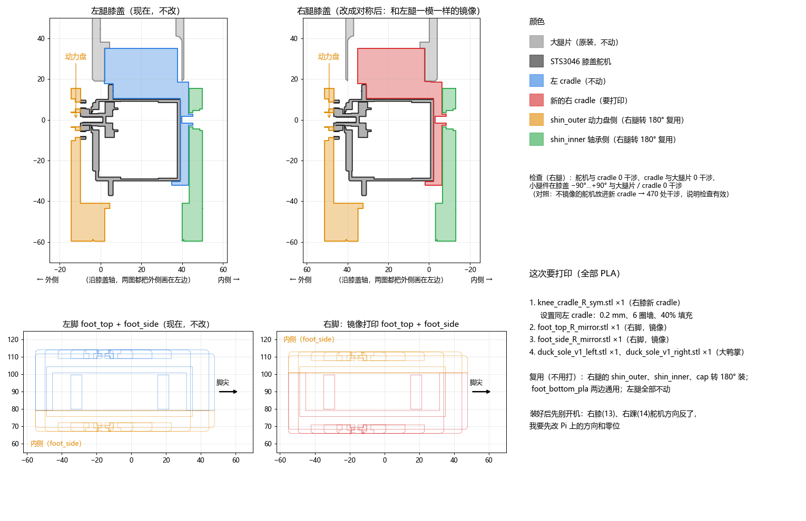

# 左右腿对称改造记录（2026-11-11 ～ 11-13）

[English](symmetric_legs_retrofit.md)

## 一句话结论

右腿原来是左腿的**同一套零件直接转过来装**的（"顺拐"）：膝盖和脚踝的舵机动力盘在左腿朝**外**，在右腿却朝**内**。把右腿改成左腿的**镜像**（两条腿的动力盘都朝外）以后，鸭子直着走**不再往一边偏**，左右转的速度也**平衡了很多**。

## 问题

- 走直线总要一直往右修正方向（11-10：陀螺仪方向保持一直在加 −4 ～ −13°/s 的修正，手动方向微调 −0.3）。
- 左转明显比右转弱，横移时一边好一边差。
- 换过舵机、重新校准零位、改过方向偏置（TURN_BIAS），都只能压住一部分。

## 找原因

1. **质量分布不是原因。** 官方仿真模型的左右腿质量和重心已经是镜像对称的（`tools/leg_symmetry.py`：每个零件左右重心相差 0.6～1.4 mm，整条腿 413.5 g）。所以刚体仿真"看不见"装法的差别。
2. **差别在动力盘那一侧的间隙。** 舵机输出轴（动力盘）一侧连接紧，另一侧靠轴承，有一点左右晃动的间隙。右腿装反以后，两条腿的间隙在身体的同一侧，不再左右对称。
3. **仿真验证。** 在仿真里给膝盖、脚踝加上动力盘一侧的侧向间隙（`tools/knee_play_sim.py`，`DUCK_PLAY` 环境变量接到 `tools/mjlab_sim_check.py`），对比"同向装（顺拐）"和"镜像装"（`tools/play_compare.sh` + `play_compare_table.py`，每种 18 场）：
   - 顺拐装法会让鸭子走路时**横向漂移 +7 ～ +12 mm/s**；
   - **左右转速度差 4 ～ 5°/s**；
   - 两种装法都不摔。

所以决定：**右腿做成左腿的镜像**。

## 改了什么

| 零件 | 做法 | 文件 |
| --- | --- | --- |
| 右膝 cradle（舵机托架） | 新打印：左 cradle 的舵机侧镜像过来，再按真实的右大腿片开孔（M3） | `cad/symmetric_legs/knee_cradle_R_sym.stl`（脚本 `knee_v1c_right_sym.py`） |
| 右脚 foot_top / foot_side | 镜像打印 | `foot_top_R_mirror.stl`、`foot_side_R_mirror.stl` |
| 右脚（带黑马脚底开关板的槽） | 镜像 + 开关槽 10.5×77 mm + 4 个 PCB 孔 | `foot_top_R_mirror_slot.stl`、`foot_side_R_mirror_slot.stl`（脚本 `foot_R_switch_slot.py`） |
| shin_outer / shin_inner / cap | **不用重打**：这几个零件前后严格对称（`tools/knee_fore_aft_check.py`），右腿转 180° 装就是镜像 | — |
| 左腿 | 不动 | — |

- 全部用 PLA。装配前用 `tools/knee_R_fit.py` 检查：舵机、cradle、大腿片、小腿件在 −90°～+90° 内 0 处干涉（对照：不镜像的舵机放进去有 470 处干涉，说明检查有效）。
- 镜像后右腿重心横向只移动约 0.3～0.4 mm，可以忽略。仿真模型本来就是对称的，**不需要重新训练**。

## 装好后一定要改树莓派上的设置

右膝（ID 13）和右踝（ID 14）镜像以后，**舵机转动方向反了**。开机前：

1. 在 `~/duck_config.json` 里加 `"reversed_joints": ["right_knee", "right_ankle"]`（运行时的 `joints_sign`）。
2. 腿伸直扶好，用 `tools/set_middle.py --id 13 --calibrate`、`--id 14 --calibrate` 重新校零位。
3. 先在支架上小角度测方向：给 +10°，看左右小腿、脚是不是往同一个方向动。

> 我们第一次只看了膝盖，脚踝 10° 的动作很难看清，以为没反；一上电右脚就歪了约 90°（= 2 × 站立时脚踝角 46°），才确认脚踝也反了。**两个关节都要改。**

## 结果（真机，od29 模型，光滑底板）

| | 11-10 旧装法 | 11-13 对称后 |
| --- | --- | --- |
| 直走需要的方向修正 | 一直 −4 ～ −13°/s | **约 0**（剩下约 −2°/s 漂移） |
| 右转 | −2 ～ −10°/s | **−15 ～ −17°/s** |
| 左转 | +1 ～ +11°/s | **+9 ～ +14°/s** |
| 转 87° 用时 | 经常超时 | 5 ～ 7 s |

主人的感受："左右转明显平衡了"。

注意：

- 软的瑜伽垫、硬麻点防滑垫上前后晃动会大一倍，左转又会失败；光滑硬底板最好。这是地面的问题，不是对称的问题。
- 左右转还不完全一样（右转快一点），剩下的差别主要来自模型本身。

## 用到的工具

| 文件 | 作用 |
| --- | --- |
| `tools/leg_symmetry.py` | 比较仿真模型左右腿每个零件的质量和重心 |
| `tools/knee_play_sim.py` | 给膝盖 / 脚踝加动力盘一侧的侧向间隙（`DUCK_PLAY="度数:刚度:same|mirror[:knee+ankle]"`） |
| `tools/play_compare.sh`、`play_compare_table.py` | 同向 vs 镜像各跑 18 场，出对比表 |
| `tools/knee_mirror_frame.py` | 在仿真里求出右腿的镜像平面 |
| `tools/knee_fore_aft_check.py` | 检查小腿件是否前后对称（能否转 180° 复用） |
| `tools/mirror_feet_parts.py` | 把官方脚部零件镜像成右脚 |
| `tools/knee_R_fit.py` | 右膝装配干涉检查 |

脚本里的路径是作者电脑上的路径（WSL `/mnt/d/...`），使用前改成自己的。
